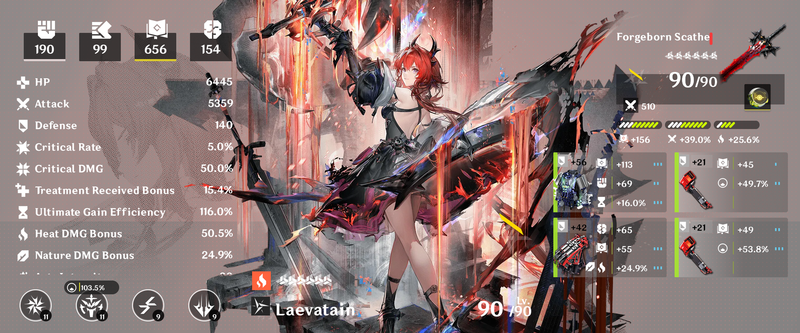
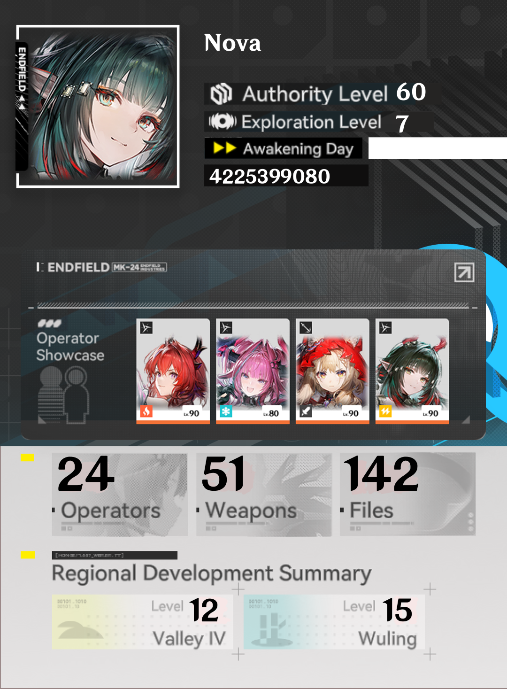

# Endfield Cards

[](https://pypi.org/project/endfield-cards/)
[](https://www.python.org/downloads/)
[](LICENSE.txt)

A powerful Python library for generating beautiful character and profile cards for **Endfield**. This library provides an easy-to-use interface to create stunning visual cards with character stats, weapons, relics, and profile information.

## Features

**Beautiful Card Templates** - Multiple professional templates for character showcase and profile cards

**Complete Character Information** - Display stats, skills, weapons, relics, and more

**Profile Cards** - Generate comprehensive profile cards with operator showcase

**Async Support** - Full async/await support for efficient operations

**Caching** - Smart asset caching for improved performance

**Easy Integration** - Simple API for quick integration into your projects

## Installation

### From PyPI (Recommended)

```bash
pip install endfield-cards
```

### From Source

```bash
git clone https://github.com/MR-LORD-REX/endfield-cards.git
cd endfield-cards
pip install -e .
```

## Dependencies

This library depends on:

- **[endfield-py](https://github.com/MR-LORD-REX/endfield)** - Core Endfield game data client
- **[enka.network](https://enka.network)** - Player data and asset provider


## Quick Start

### Basic Usage

```python
import asyncio
from ef_cards import EFCard

async def main():
    uid = 4225399080  # Your Endfield UID
    
    # Using async context manager (recommended)
    async with EFCard() as ef_card:
        # Get a single character card
        char_card = await ef_card.get_character_card(uid, char_index=0)
        char_card.save("character_card.png")
        
        # Get all characters cards
        all_cards = await ef_card.get_all_characters_card(uid)
        
        # Get profile card with showcase
        profile = await ef_card.get_profile_card(uid)
        profile.card.save("profile_card.png")

if __name__ == "__main__":
    asyncio.run(main())
```

### Without Context Manager

```python
import asyncio
from ef_cards import EFCard

async def main():
    ef_card = EFCard()
    try:
        char_card = await ef_card.get_character_card(4225399080, char_index=0)
        char_card.save("character_card.png")
    finally:
        await ef_card.close()  # Don't forget to close!

if __name__ == "__main__":
    asyncio.run(main())
```

## Available Methods

### Character Card

```python
# Get a single character card
card = await ef_card.get_character_card(
    uid: int,
    char_index: int = 0,
    user_img: Image.Image | None = None,
    template: int = 1
) -> Image.Image
```

### All Characters Cards

```python
# Get cards for all characters in a profile
cards = await ef_card.get_all_characters_card(
    uid: int,
    user_imgs: list[Image.Image] | None = None,
    template: int = 1
) -> list[Image.Image]
```

### Profile Card

```python
# Get a complete profile card with showcase
profile = await ef_card.get_profile_card(
    uid: int,
    template: int = 1
) -> ProfileCard_1
```

## Card Information

### Character Card Template 1 (1920x800)

Displays comprehensive character information including:

- **Main Frame** - Character artwork and basic stats
- **Weapon Panel** - Current weapon with stats
- **Relic Panel** - Equipped relics and bonuses
- **Skill Panel** - Character skills and cooldowns
- **Stats Panel** - Detailed character statistics

### Profile Card Template 1 (1080x1467)

Includes:

- **Player Profile** - UID, Authority Level, Exploration Level
- **Awakening Day** - Days since account creation
- **Operator Showcase** - 4 featured characters
- **Statistics** - Total operators, weapons, and files collected
- **Regional Development** - Development levels by region

## Example Output

### Character Card


### Profile Card


## Data Sources

- **Game Data**: [endfield-py](https://github.com/MR-LORD-REX/endfield) - Endfield game data wrapper developed by me
- **Assets & Player Data**: [enka.network](https://enka.network) - Community-driven asset and player data provider

## Configuration

### Debug Mode

Enable debug logging to troubleshoot issues:

```python
async with EFCard(debug=True) as ef_card:
    # Your code here
    pass
```

### Custom Endfield Client

Use your own Endfield client instance:

```python
from endfield import Endfield

ef = Endfield()
async with EFCard(ef=ef) as ef_card:
    # Your code here
    pass
```


## Contributing

Contributions are welcome! Please feel free to submit a Pull Request.

## License

This project is licensed under the MIT License - see the [LICENSE.txt](LICENSE.txt) file for details.

## Disclaimer

This project is not affiliated with or endorsed by the developers of Endfield. All assets and game data are sourced from public APIs and are used for educational purposes only.

## Acknowledgments

- **endfield-py** - Library developed by me for accessing Endfield game data
- **enka.network** - For providing player data and asset caching

## Support

If you encounter any issues or have questions:

1. Check the [examples](src/examples/) directory for usage patterns
2. Enable debug mode to see detailed logs
3. Open an issue on [GitHub](https://github.com/MR-LORD-REX/endfield-cards/issues)

## Related Projects

- [endfield-py](https://github.com/MR-LORD-REX/endfield) - Core Endfield game data client

---

**Note**: Make sure you have a valid Endfield UID to use this library. You can find your UID in-game .
