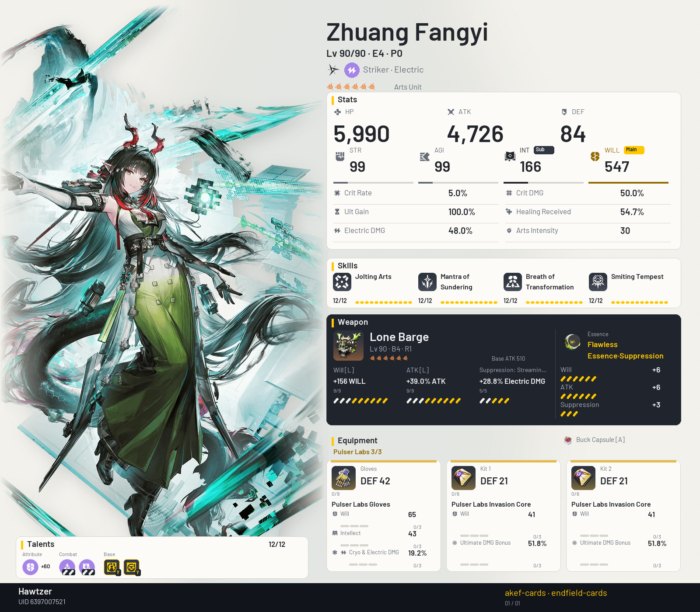
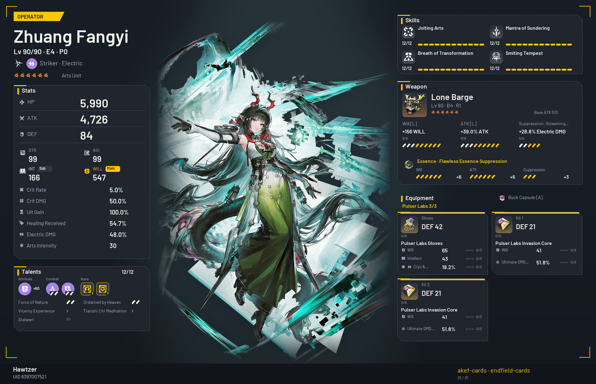
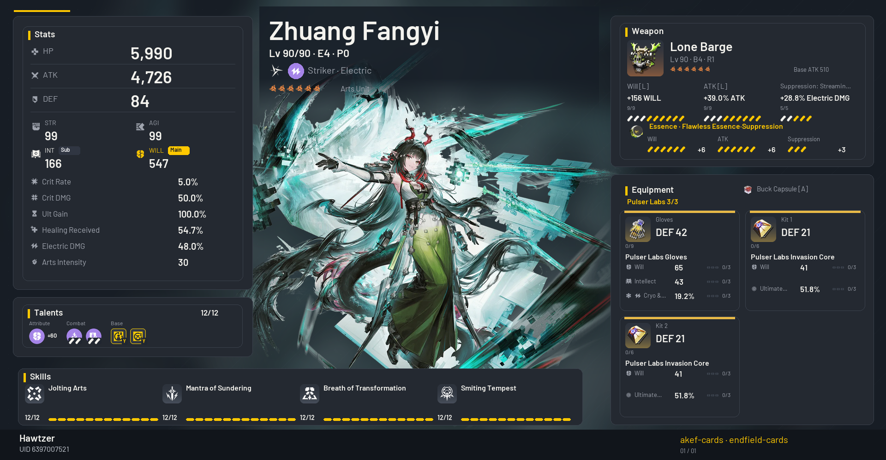
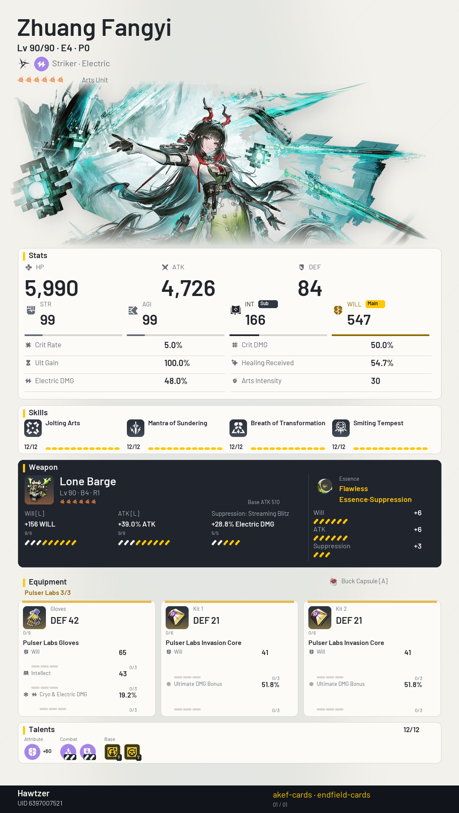

# Character cards

Create an operator showcase with artwork, stats, skills, weapon, essence, equipment, and talents.

```python
result = await cards.character_card(
    skport_id, name="Zhuang Fangyi", template=1
)
result.card.save("output/character.png")
build = result.model
```

Choose one of `char_id`, localized `name`, or zero-based `index`. If you omit all selectors, the first returned operator is selected. Use opaque IDs from [Profile](profile.md) `.info.characters`; IDs are specific to the player's account.

`full=True` fetches full character details. `showcase_only=True` restricts public index selection to the exposed showcase. For your own account, pass `token=owner_token` and optionally `role` instead of a public ID; `showcase_only` applies only to public requests.

The result contains a `CharacterBuild` in `.model`; `.info` is `None`. White weapon capsules show confirmed base levels and yellow capsules show confirmed essence bonuses. Combat talent capsules represent observed talent levels.

Use `art=` for [custom artwork](../guides/artwork.md). `details=True` appends supplementary build records.

## Template 1



## Template 2



## Template 3



## Template 4


