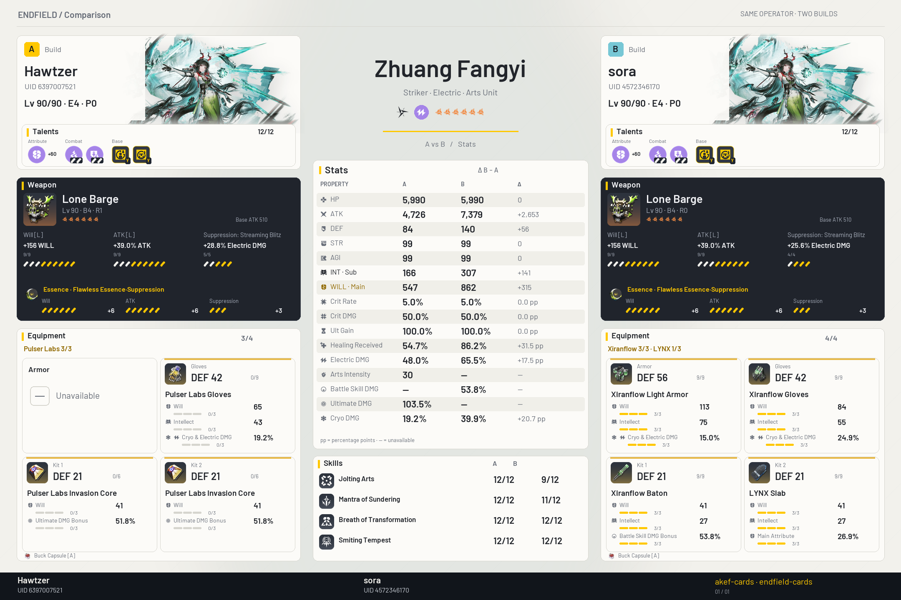
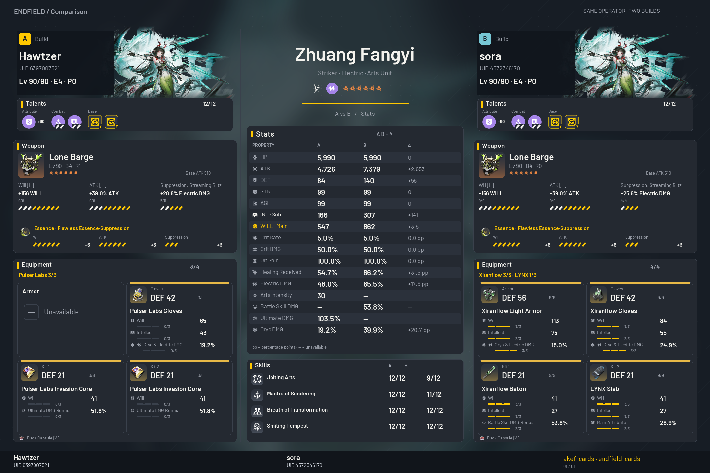

# Compare cards

Compare the same operator across two public profiles, including stats, skills, weapon, essence, equipment, and talents.

```python
result = await cards.compare_card(
    first_skport_id,
    second_skport_id,
    name="Zhuang Fangyi",
    template=1,
)
result.card.save("output/compare.png")
first_build, second_build = result.model
```

Select the first player's operator with one of `char_id`, `name`, or `index`. With no selector, index 0 is used. The second operator is selected by the first operator's localized name unless you supply `second_char_id`.

Opaque character IDs can differ across accounts. Use each player's returned ID when supplying `char_id` and `second_char_id`.

```python
result = await cards.compare_card(
    first_skport_id,
    second_skport_id,
    char_id=first_character_id,
    second_char_id=second_character_id,
    template=2,
)
```

`.model` is a `(first, second)` pair of full `CharacterBuild` models; `.info` is `None`. Optional `art` and `second_art` override each player's [artwork](../guides/artwork.md). `details=True` appends supplementary build pages.

## Template 1



## Template 2


