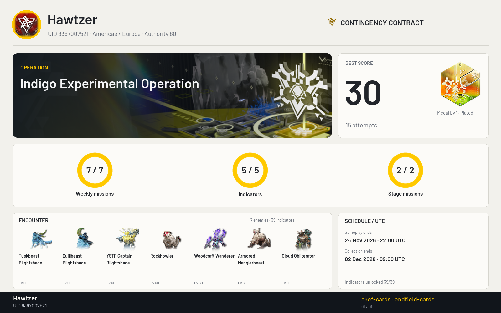
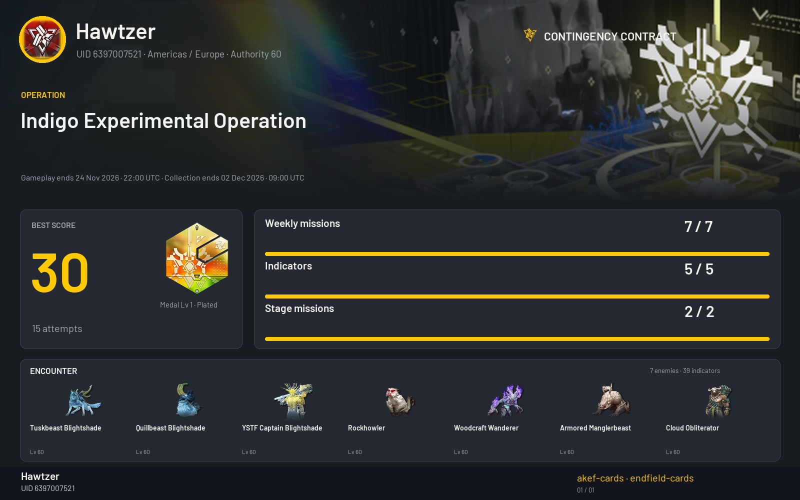
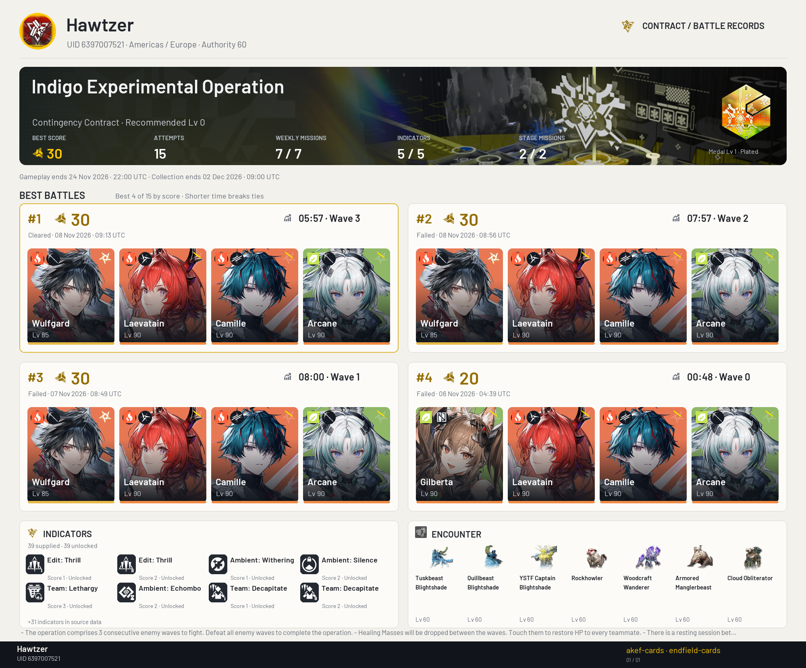
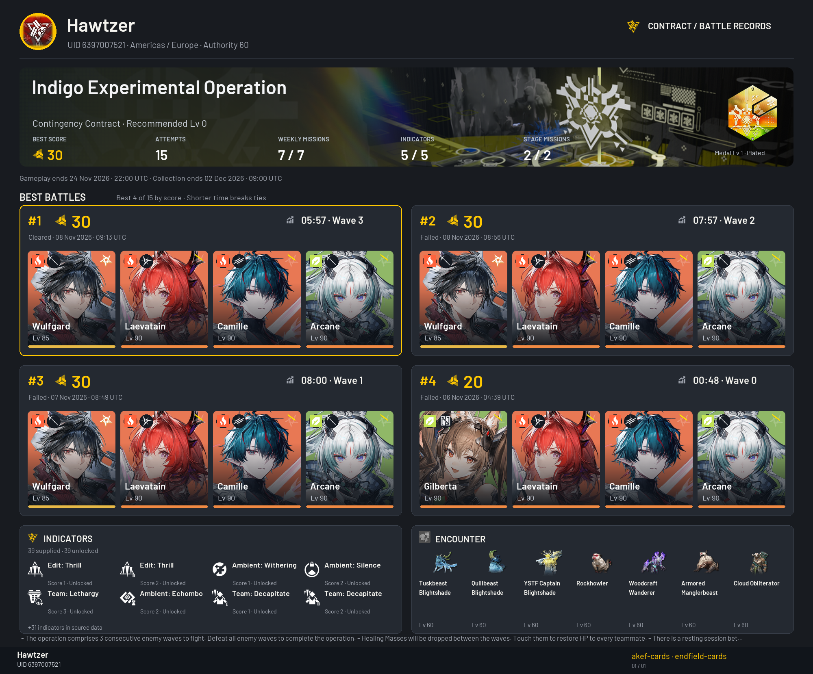

# Contingency Contract cards

Use the overview for operation progress and the detailed method for battle records and indicators.

## Overview

```python
result = await cards.contingency_contract_card(skport_id, template=1)
result.card.save("output/contingency_contract.png")
for contract in result.info.contracts:
    print(contract.name, contract.id)
```

The overview shows supplied operation artwork, best score, attempts, medal, mission progress, enemies, and deadlines. `contract_id` optionally selects a specific contract; otherwise the current contract, or first supplied contract, is selected. `details=True` appends supplementary records.

### Template 1



### Template 2



## Detailed contract

```python
result = await cards.contingency_contract_detailed_card(
    skport_id, contract_id=contract_id, template=2
)
result.card.save("output/contingency_contract_detailed.png")
```

The detailed card shows the selected operation's best supplied battle records and their observed teams, indicators, and enemies. When there are no supplied battles, the card emphasizes the available indicators. Historical equipment is not inferred from current builds.

Both methods return the complete `ContractState` in `.model` and `ContractInfo` in `.info`. Detailed `.info.contracts` describes the selected contract. Omit `contract_id` to use the current/first supplied contract, or use an ID returned by the overview.

### Template 1



### Template 2


