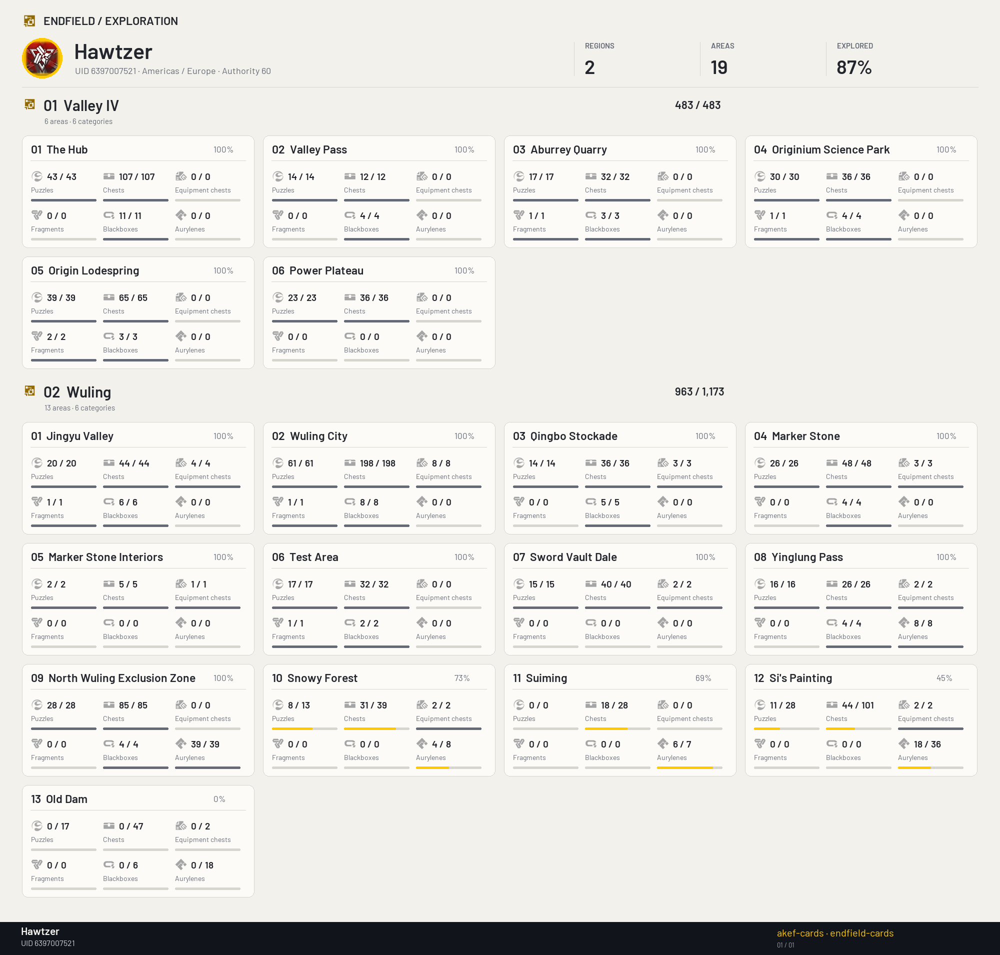
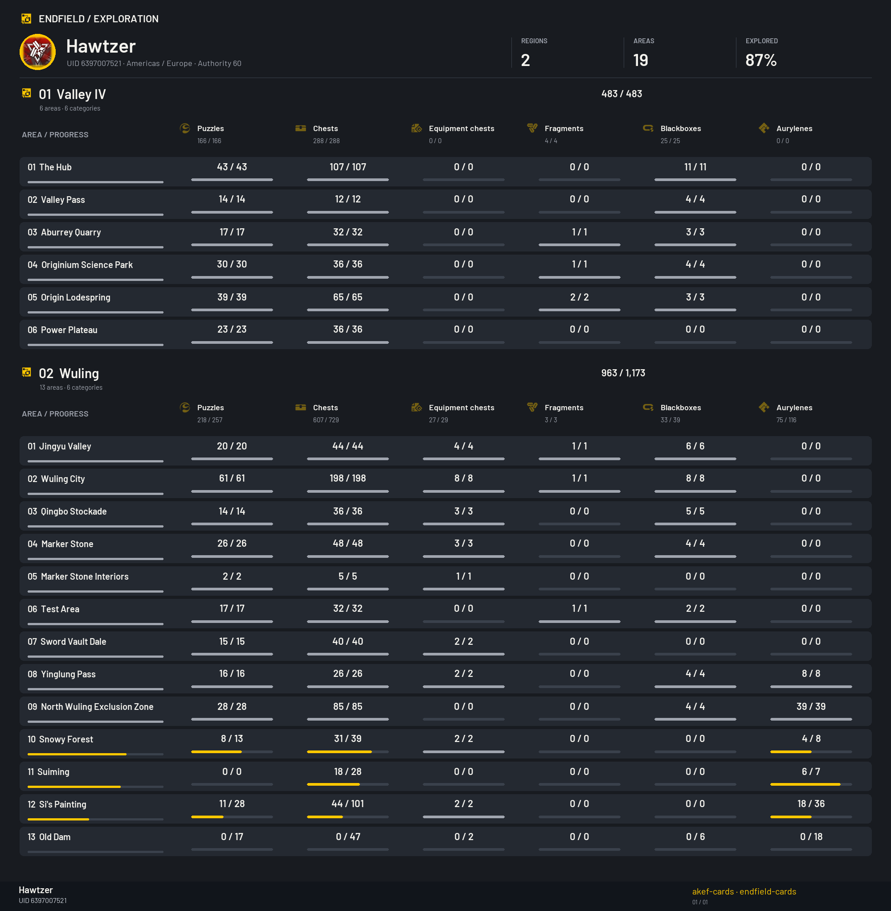

# Exploration cards

Show exploration progress across every supplied region and area, including category counters such as chests and collectibles.

```python
result = await cards.exploration_card(skport_id, template=1)
result.card.save("output/exploration.png")
state = result.model
```

Pass the player's public `skport_id` and choose template `1` or `2`. `role_id` and `server_id` optionally select a particular bound public account.

The result contains the complete `FactoryState` in `.model`; `.info` is `None`. The card shows exploration only. Use [Factory](factory.md) for funds, settlements, and Dijiang.

Missing counts and maxima retain their supplied state. The image does not invent exploration totals for missing areas.

## Template 1



## Template 2


