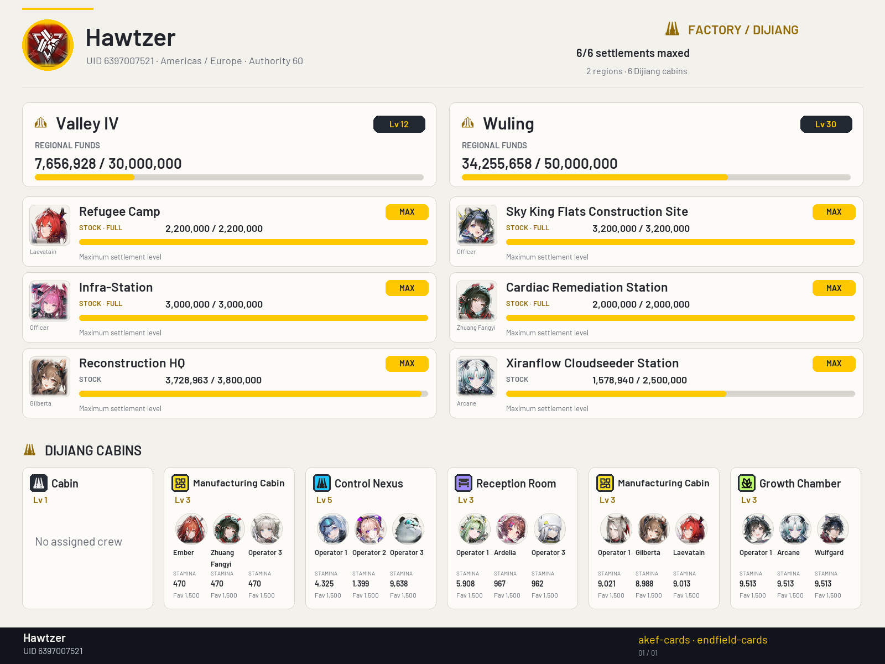
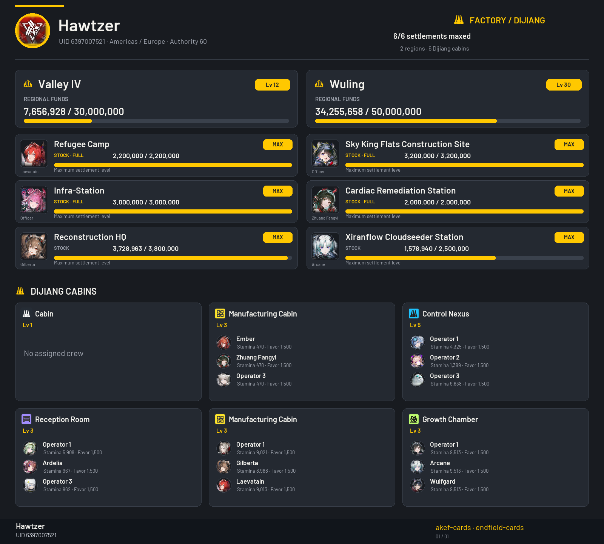

# Factory cards

Show regional factory funds, settlement status, and Dijiang cabins with their assigned crew.

```python
result = await cards.factory_card(skport_id, template=1)
result.card.save("output/factory.png")
factory = result.model
```

Pass the player's public `skport_id` and choose template `1` or `2`. `role_id` and `server_id` optionally select a particular bound public account.

The card contains factory and Dijiang information. [Exploration](exploration.md) has its own card method.

The result contains the complete `FactoryState` in `.model`; `.info` is `None`. The factory and exploration methods share this SDK model, so the source data can include both systems even though the images show them separately.

## Template 1



## Template 2


