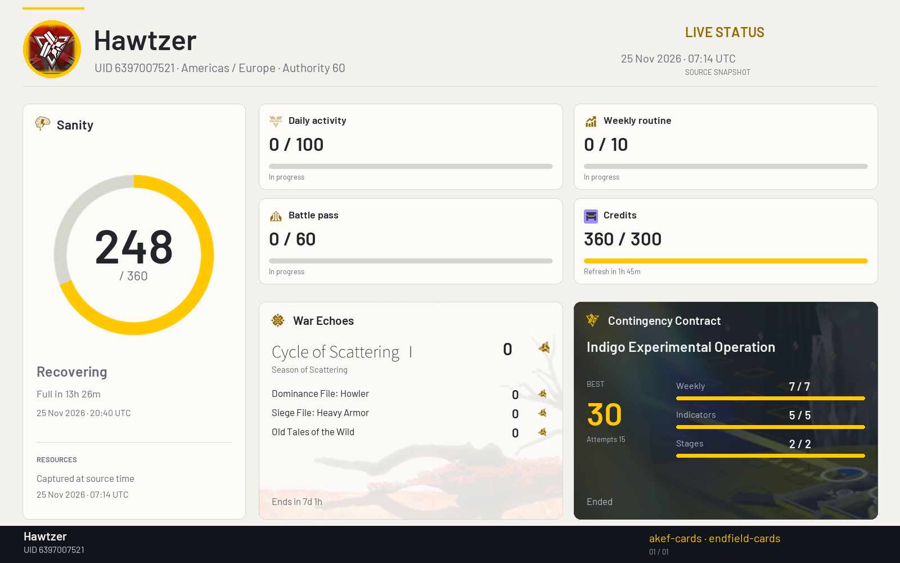
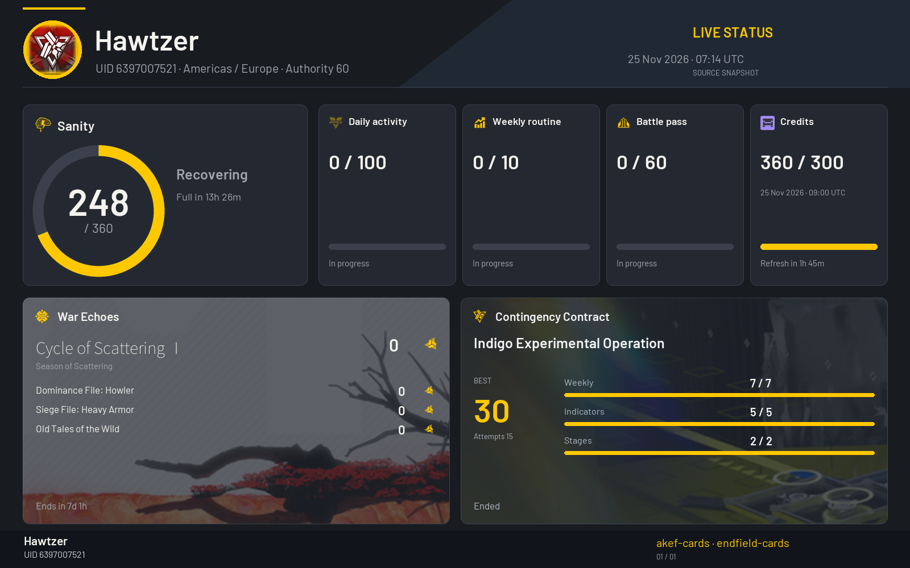

# Live cards

Show current resources, activity progress, War Echoes, and Contingency Contract status supplied by skport-py.

```python
result = await cards.live_card(skport_id, template=1)
result.card.save("output/live.png")
print(result.info.fully_replenished_at)
```

Use a public `skport_id`, or supply `token=owner_token` and optionally `role` for the authenticated owner's data:

```python
result = await cards.live_card(token=owner_token, template=2)
```

The result contains `LiveStatus` in `.model` and `LiveInfo` in `.info`. Live deadlines use UTC, including the supplied Sanity recovery time. Values reflect the fetched snapshot; opening a saved image does not refresh them.

Unavailable meters remain unavailable, and the card does not estimate missing recovery times. `details=True` adds supplementary activity records.

## Template 1



## Template 2


