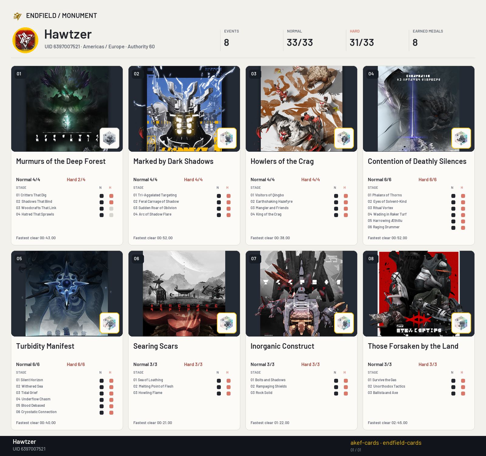
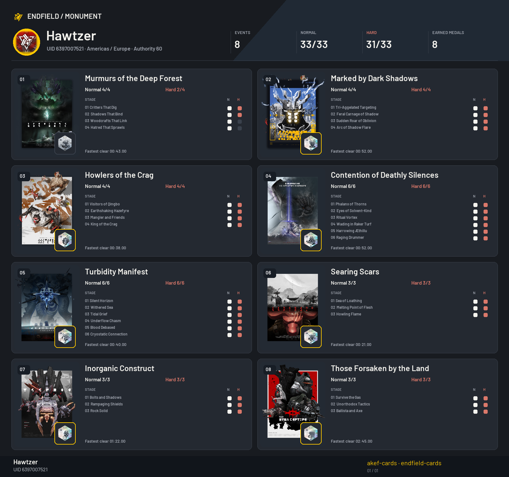
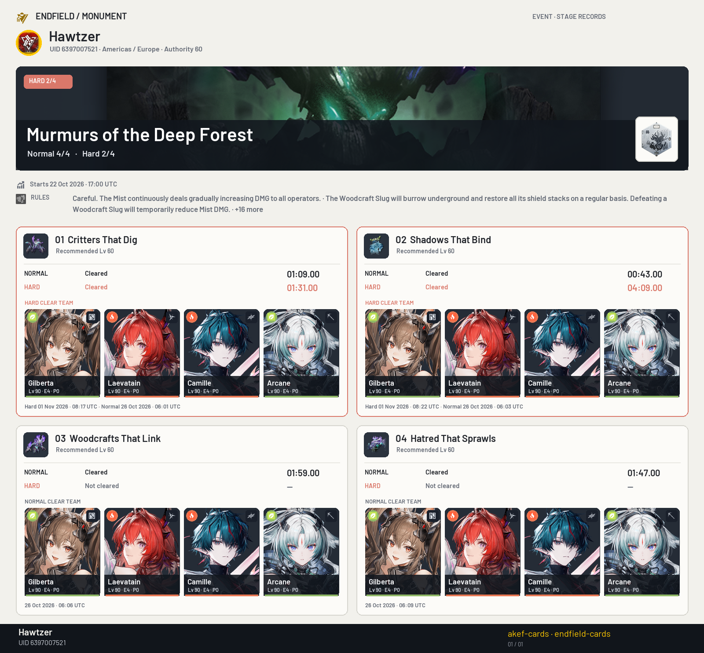
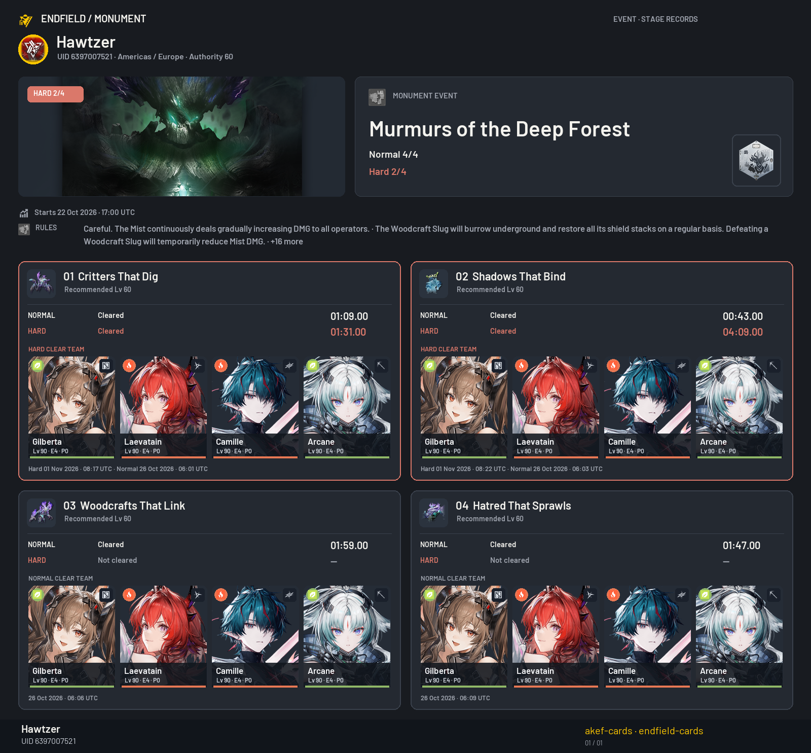

# Monument cards

Use the overview for event progress and medals, or the detailed method for stage records and their observed teams.

## Overview

```python
result = await cards.monument_card(skport_id, template=1)
result.card.save("output/monument.png")
for event in result.info.events:
    print(event.name, event.id)
```

The overview shows supplied events, Normal and Hard clear progress, medal artwork, stage names, and recorded fastest clears. `event_id` optionally selects a specific event. `details=True` appends supplementary event and stage records.

### Template 1



### Template 2



## Detailed event

```python
result = await cards.monument_detailed_card(
    skport_id, event_id=event_id, template=2
)
for page in result.cards:
    page.save(f"output/monument_detailed/{page.page}.png")
```

Omit `event_id` to select the active event, otherwise the latest supplied event. The card shows stage/enemy icons, Normal and Hard clear records, durations, and observed team portraits. Larger events paginate.

Both methods return the complete `MonumentState` in `.model` and `MonumentInfo` in `.info`. The detailed method's `.info.events` describes the selected event. Use returned IDs for subsequent selections.

### Template 1



### Template 2


