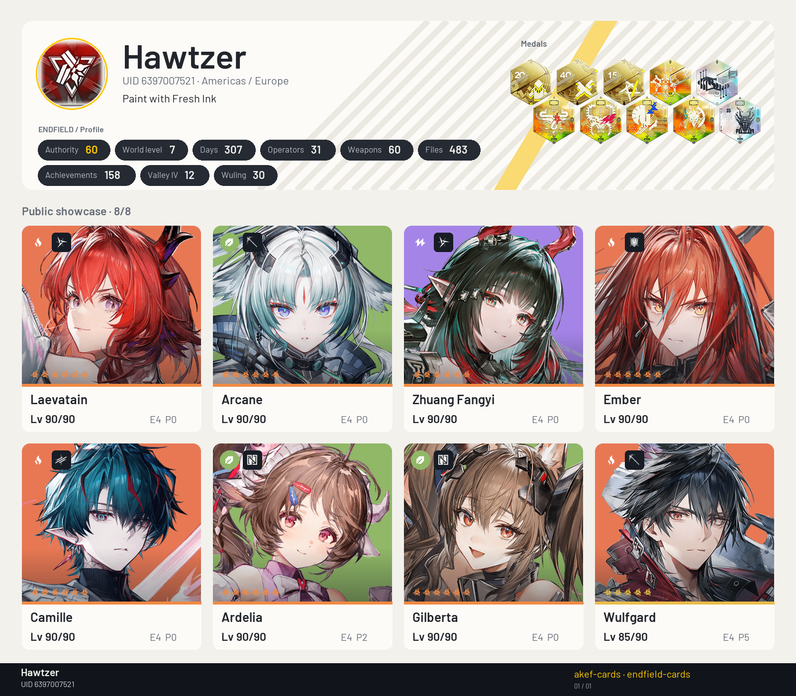
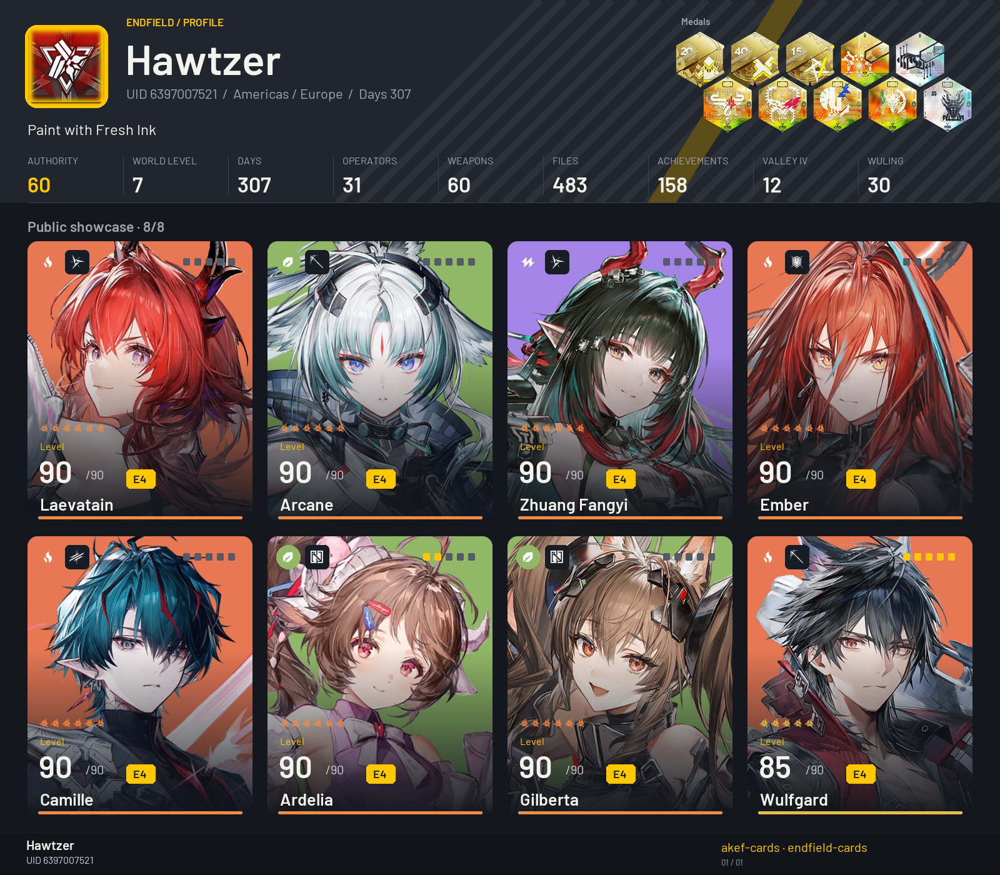
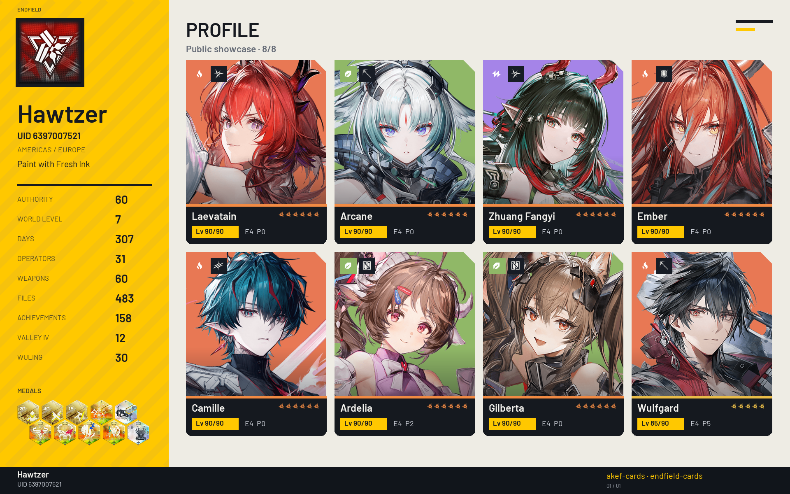

# Profile cards

Show a player's identity, progression, medals, and exposed character showcase.

```python
result = await cards.profile_card(skport_id, template=1)
result.card.save("output/profile.png")
```

`skport_id` is the target's public SKPORT ID. The viewer account is configured through the injected SDK. For your own account, use `token=owner_token` with an optional `role` instead of `skport_id`.

The result contains a `PlayerCard` in `.model` and `CharacterListInfo` in `.info`. Use `.info.characters` to select a character for a later [character card](character.md):

```python
for character in result.info.characters:
    print(character.name, character.id)
```

A public showcase contains characters exposed by the player. For an authenticated collection, use [All Characters](roster.md).

## Template 1



## Template 2



## Template 3



`details=True` appends supplementary profile records. Iterate `.cards` when requesting those pages. [Card results](../guides/card-results.md) explains saving and pagination.
