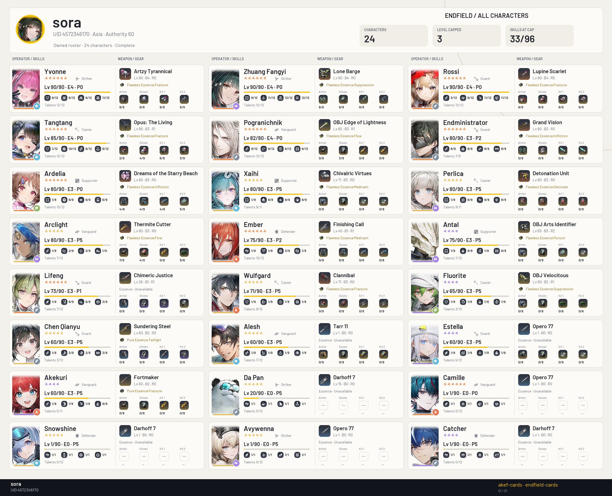
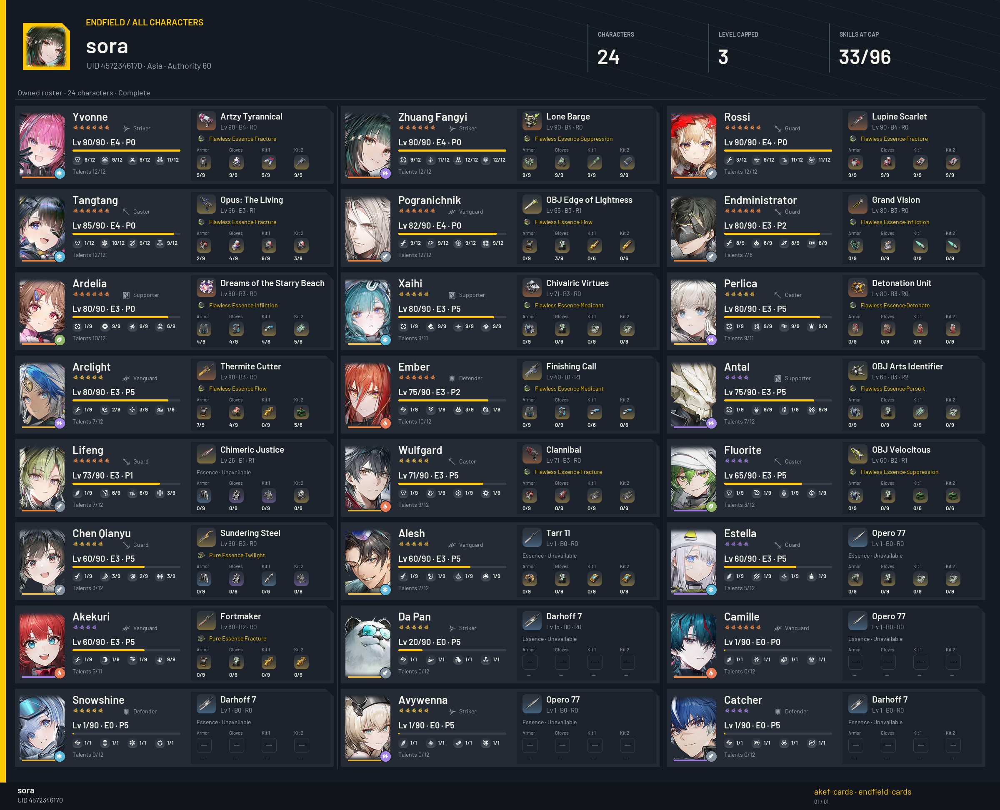

# All Characters cards

Show an authenticated owner's returned operator collection, with levels, skills, talents, weapons, essence, and equipment.

```python
result = await cards.all_characters_card(owner_token, template=1)
for page in result.cards:
    page.save(f"output/all_characters/{page.page}.png")
```

This method requires the owner's account token. It does not take a public SKPORT ID. Follow skport-py's [owner-account guide](https://mr-lord-rex.github.io/skport-py/#/guides/owner-accounts) and [token instructions](https://mr-lord-rex.github.io/skport-py/#/getting-started/account-tokens).

Pass `role` to choose one of that owner's bound accounts. `full=True` fetches full builds. `character_ids` optionally filters the returned collection while preserving its order:

```python
result = await cards.all_characters_card(
    owner_token,
    template=2,
    character_ids=[first_character_id, second_character_id],
)
```

`.model` is a list of `CharacterBuild` models; `.info` is `CharacterListInfo` with owner scope and character selectors. Large collections can span multiple pages. `details=True` appends supplementary identity records.

## Template 1



## Template 2


